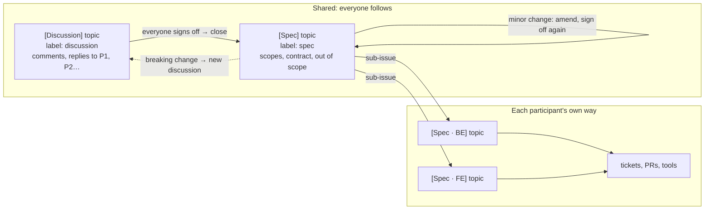

# cowork-skills

Skills for running design discussions between several people on GitHub Issues. One person, the facilitator, drives the discussion; everyone else contributes by commenting. Anyone can use the skill in either role, and contributors don't need Claude at all.

Only the discussion part is covered. Turning a shared spec into each person's own specs and tickets stays with whatever workflow each person uses.

## Install

```sh
npx skills add nguyenhaiduc06/cowork-skills
```

Run it inside the repo where discussions happen (it installs into the current project). Needs [`gh`](https://cli.github.com/), logged in with access to that repo. The `discussion` and `spec` labels are created on first use.

## Lifecycle



| Step      | What happens                                                                  |
| --------- | ----------------------------------------------------------------------------- |
| `open`    | Open `[Discussion] <topic>` (label `discussion`) with participants and scopes. |
| `propose` | Claude drafts numbered points to decide (`P1`, `P2`…); contributors reply.    |
| `sync`    | Claude reads all comments and updates Decided / Open in the issue body.       |
| `signoff` | Claude posts a versioned draft shared spec + contract; everyone signs off.    |
| `close`   | Once all signed off: create `[Spec] <topic>` (label `spec`), close the discussion. |
| `amend`   | Minor change to a shared spec: affected people sign off again, log it.        |

Say the step in plain words to Claude: "open a discussion with @bob about the order history page", "sync #80", "close #80". Titles follow the issue's language, e.g. `[Thảo luận] <chủ đề>`.

All steps belong to the facilitator, the person who ran `open`. A contributor who uses Claude can ask it to summarise a discussion, draft their replies to `P` points, or review a draft ("summarise #80 for me", "review the latest draft on #80"); Claude posts nothing without their approval.

The skill works with issues only. Where issues land on a GitHub Projects board is up to the board's own workflows (e.g. auto-add `label:discussion`).

## Rules everyone follows

- The issue body is a summary kept by the facilitator; the conversation is in comments.
- Sign off = a comment that says just `sign off`, written by you. It counts for the latest draft only. Claude never signs off for anyone.
- Comments starting with `🤖 Claude (for @x):` were written by Claude and approved by @x.
- The shared spec holds boundaries only: problem, solution, scopes, the contract between participants, out of scope.
- Each participant attaches at least one scoped spec as a sub-issue of the shared spec, titled `[Spec · <scope>] <topic>`. Whoever closes the last one closes the shared spec by hand.
- Minor spec change (additive) → comment on the spec. Breaking change or new boundary → new discussion.

## Example

Feature "order history page", two participants: @alice (BE: orders API) and @bob (FE: web app). @alice facilitates.

1. `open` → `[Discussion] Order history page` #80.
2. `propose` → P1 pagination style, P2 which statuses to show, P3 what the page shows on error. @bob replies `P1: ok`, `P2: no, also show cancelled orders`.
3. @alice runs `sync`: P1 and P3 move to Decided, P2 settled after one more reply.
4. `signoff` → Draft v1 with contract `GET /orders?cursor=…` → `{ items: [{ id, status, total, created_at }], next_cursor }`, plus `401` and `5xx` cases.
5. Both comment `sign off`.
6. `close` → `[Spec] Order history page` #81; #80 closed.
7. Each side attaches a scoped spec under #81: `[Spec · BE] Order history page` #82, `[Spec · FE] Order history page` #83. Each works their own way.
8. FE needs a tracking link → `amend`: add optional `tracking_url`, minor, both sign off again on #81. #82 and #83 close, then #81.

## License

MIT
